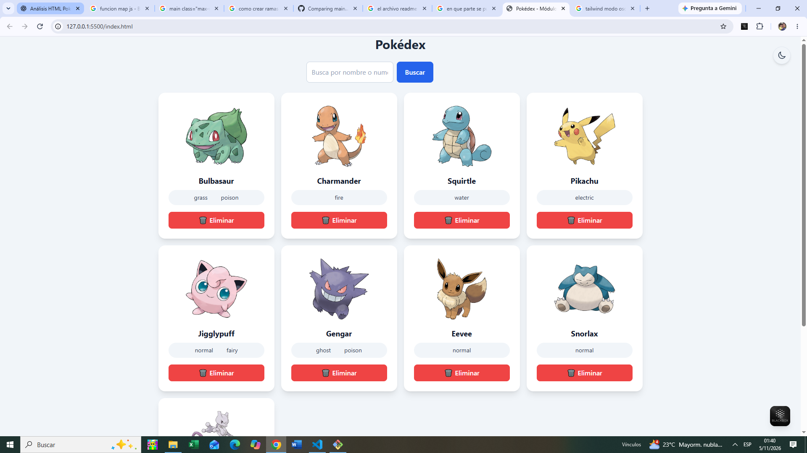
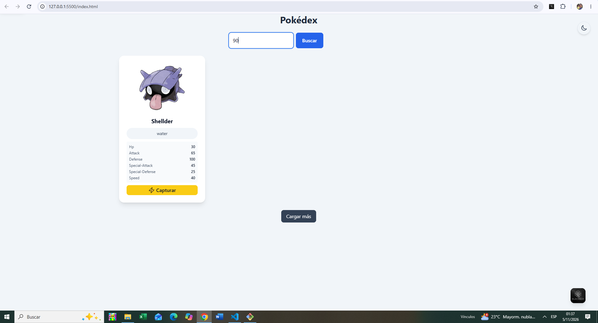
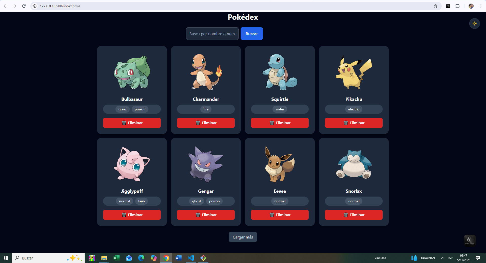
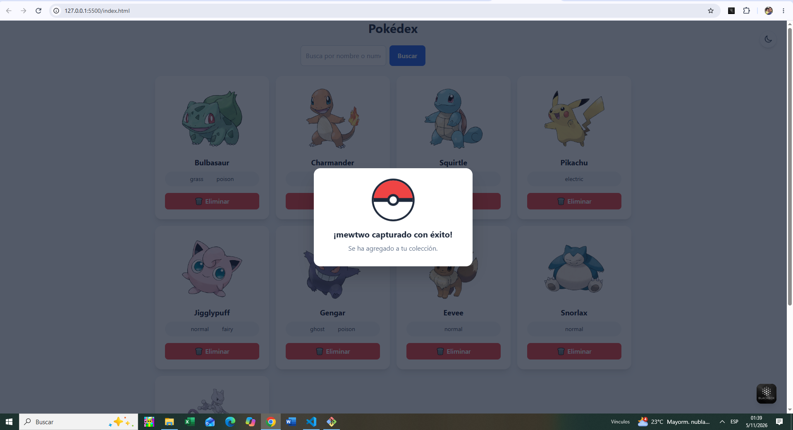

# ⚡ Pokédex - Módulo 3

Aplicación web interactiva que permite consultar Pokémon mediante la API de PokéAPI, visualizar sus características, capturarlos y administrar una colección personal.

El proyecto está desarrollado con HTML5, JavaScript y Tailwind CSS, aplicando conceptos de manipulación del DOM, consumo de API, funciones asíncronas y manejo de eventos.

## 🚀 Tecnologías utilizadas

- **HTML5:** estructura de la aplicación.
- **JavaScript:** lógica, funcionalidades y manipulación del DOM.
- **Tailwind CSS:** estilos, diseño responsive y modo oscuro.
- **PokéAPI:** API externa para obtener información de los Pokémon.
- **LocalStorage:** almacenamiento de la preferencia del tema seleccionado.

## ✨ Funcionalidades implementadas

### 1. Carga inicial de Pokémon
- Muestra 8 Pokémon al iniciar la aplicación.
- Presenta imágenes oficiales, nombres y tipos.
- Organiza las tarjetas mediante CSS Grid.

### 2. Búsqueda de Pokémon
- Permite buscar por nombre o número.
- Utiliza un único campo de búsqueda.
- Muestra información del Pokémon encontrado.
- Presenta sus estadísticas básicas.

### 3. Indicador de carga y manejo de errores
- Muestra un spinner animado mientras se consultan los datos.
- Presenta mensajes cuando ocurre un error.
- Incluye un botón para reintentar la última búsqueda.

### 4. Capturar Pokémon
- Permite capturar un Pokémon después de realizar una búsqueda exitosa.
- Agrega el Pokémon a la colección.
- Evita capturar Pokémon duplicados.
- Limpia el campo de búsqueda después de capturar.

### 5. Animación de captura (HU1)
- Incorpora una Pokébola animada mediante CSS.
- Simula el movimiento de captura.
- Muestra un mensaje personalizado: ¡Pokémon capturado con éxito!
- Utiliza animaciones con `@keyframes` y JavaScript.

### 6. Eliminar Pokémon (HU2)
- Cada tarjeta de la colección tiene un botón **Eliminar**.
- Permite retirar un Pokémon seleccionado.
- Actualiza la colección sin recargar la página.
- Mantiene los demás Pokémon de la colección.
- El botón Capturar aparece únicamente en los resultados de búsqueda.

### 7. Cargar más Pokémon
- Permite ampliar la colección mediante el botón Cargar más.
- Consulta nuevos Pokémon utilizando la paginación de PokéAPI.
- Carga 12 Pokémon adicionales por solicitud.
- Evita agregar Pokémon duplicados.

### 8. Modo oscuro y modo claro
- Incluye un botón para alternar entre ambos temas.
- Utiliza iconos SVG de luna y sol.
- Aplica estilos dinámicos mediante las clases `dark:` de Tailwind CSS.
- Guarda la preferencia del usuario en `localStorage`.
- Mantiene el tema seleccionado al recargar la página.

## 📂 Estructura del proyecto

```text
pokedex-modulo-3/
│
├── index.html
├── script.js
├── README.md
│
└── capturas/
    ├── pokedex-inicio.png
    ├── pokedex-busqueda.png
    ├── pokedex-modo-oscuro.png
    └── pokedex-captura.png
```

## ⚙️ Instalación y ejecución

1. Clonar el repositorio:

```bash
git clone URL_DE_TU_REPOSITORIO
```

2. Abrir la carpeta del proyecto en Visual Studio Code.

3. Ejecutar `index.html` utilizando la extensión Live Server.

4. Disfrutar de las funcionalidades de la Pokédex.

**Importante:** se necesita conexión a Internet para cargar Tailwind CSS desde CDN y consultar los datos de PokéAPI.

## 🧠 Conceptos de JavaScript aplicados

Durante el desarrollo se han utilizado los siguientes conceptos:

- Variables y constantes (`let`, `const`).
- Funciones y funciones flecha.
- Clases y manipulación de elementos HTML mediante el DOM.
- Eventos `click` y `keydown`.
- Arreglos y métodos `map()`, `filter()`, `some()` y `forEach()`.
- Promesas y programación asíncrona (`async/await`).
- Manejo de errores con `try/catch/finally`.
- Consumo de API mediante `fetch()`.
- Almacenamiento local con `localStorage`.
- Manipulación de clases CSS mediante `classList`.

## 📸 Capturas de pantalla

### Pokédex - Vista inicial



### Búsqueda de Pokémon



### Modo oscuro



### Animación de captura



## 👨‍💻 Autor

Joseph Chipana

Proyecto desarrollado como parte del aprendizaje del Módulo 3 de desarrollo web con JavaScript.